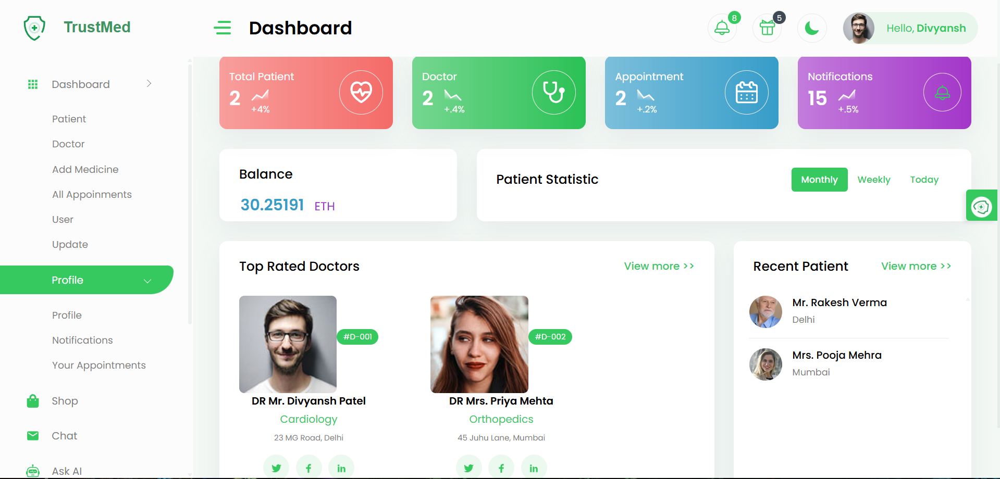

# Health Management System (TrustMed)

A next-generation Web3 healthcare DApp bringing secure, transparent, and patient-friendly healthcare management to the blockchain. Built with Ethereum, Hardhat, Next.js, and IPFS, it seamlessly integrates doctors, patients, medicine management, appointments, and AI assistance into a unified decentralized platform.

## 🚀 Key Features

* **Admin Dashboard** — Manage and monitor the system, verify doctors, manage medicines, and oversee appointments.
* **Doctor Dashboard** — Track performance, manage consultations, and prescribe digitally.
* **Doctor Profiles** — Explore medical specialties, work history, availability, and patient ratings.
* **Secure Messaging** — Real-time, blockchain-backed communication between patients & doctors.
* **AI Health Assistant** — Instant guidance for minor health queries and triage assistance.
* **Decentralized Medicine Marketplace** — Browse and order medicines securely with crypto transactions.
* **Patient Portal** — Update health records, schedule appointments, and access digital prescriptions anytime.

## 🛡️ Architecture & Tech Stack

* **Smart Contracts & Blockchain:** Solidity, Hardhat, Ethereum / Holesky Testnet, Ethers.js
* **Frontend:** Next.js (React 18), Web3Modal, React Icons
* **Decentralized Storage:** IPFS (via Pinata)
* **AI Assistance:** OpenAI API

---

## 📸 Project Overview



---

## 🛠️ Getting Started

### Prerequisites

- **Node.js**: v18.17.1 or higher
- **NPM**: 8.19.2+
- **MetaMask** browser extension installed
- **Git**

### Installation

1. **Clone the repository:**
   ```bash
   git clone https://github.com/santoshkare/Health-Management-System.git
   cd Health-Management-System
   ```

2. **Install dependencies:**
   ```bash
   npm install
   ```

3. **Configure Environment Variables:**
   Copy `.env.example` to `.env.local` and configure your credentials:
   ```bash
   cp .env.example .env.local
   ```
   Add your OpenAI API key, Pinata credentials, and network configuration.

4. **Compile Smart Contracts & Run Local Node:**
   ```bash
   npm run node
   ```

5. **Deploy Smart Contracts:**
   ```bash
   # Deploy to local hardhat network
   npm run deploy-local

   # Or deploy to Holesky testnet
   npm run deploy
   ```

6. **Start the Frontend Development Server:**
   ```bash
   npm run dev
   ```
   Open [http://localhost:3000](http://localhost:3000) in your browser.

---

## 📄 License

This project is licensed under the MIT License.

## 👤 Author

- **Santosh Kare** — [GitHub Profile](https://github.com/santoshkare)
